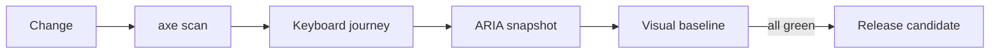

# Accessibility & Visual Quality Gates

[](https://github.com/foysal619/accessibility-visual-quality-gates/actions/workflows/quality.yml)

A compact Playwright reference project that turns inclusive UX and visual consistency into release gates. The included demo application is intentionally local and deterministic, so the suite is fast, auditable, and safe to run in CI.

## Quality layers

| Gate | Risk caught | Implementation |
|---|---|---|
| WCAG scan | detectable A/AA violations | axe-core + Playwright |
| Keyboard flow | unreachable controls and broken focus | real Tab/Enter interaction |
| ARIA snapshot | accidental semantic regressions | Playwright ARIA snapshot |
| Visual baseline | layout, color, and component drift | pixel comparison |



## Run locally

Requires Node.js 20+.

```bash
npm ci
npx playwright install chromium
npm test
```

Useful focused commands:

```bash
npm run test:a11y
npm run test:visual
npm run check
```

## Intentional design decisions

- The visual fixture contains geometric shapes and no text, reducing cross-platform font noise.
- Accessibility assertions combine automated rules with keyboard behavior and semantic snapshots; no single tool claims complete accessibility coverage.
- CI uploads the Playwright report only on failure and grants read-only repository permissions.
- Baselines are reviewed code assets. Update them only after confirming that the UI change is intentional.

## Extend this lab

Add mobile projects, authenticated fixture states, component-level snapshots, a contrast matrix, and links from failed checks to remediation guidance. For production systems, include manual screen-reader testing in the release process.

## License

MIT
